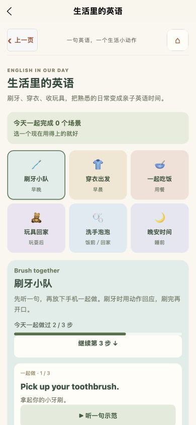
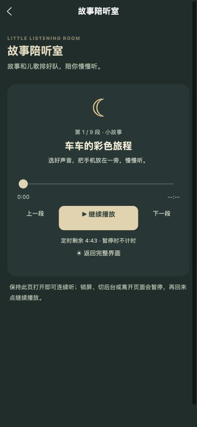

# 故事陪听室与生活场景优化 · 2026-10-25

## 本轮变化

- 播放列表支持边听边编辑：添加、移除其他曲目或调整顺序都保留当前音频、位置和定时。移除正在播放的曲目时暂停，避免突然播放另一段；加载中的音频同样不受其他曲目编辑影响。
- 循环模式下，“上一段”和“下一段”可在列表两端切换。播放出错时记录音频的最新位置，重试继续听；尚未读取到总时长时显示 `--:--`。
- 暗色陪听同步切换顶部导航配色，切换后回到页面顶部；退出时恢复完整界面和原有导航颜色。
- 生活场景显示当天完成步骤、进度条和“继续第 N 步”入口，直接定位首个未完成步骤；全部完成后收起继续按钮。每句示范可原地停止或取消加载，按钮随实际播放状态更新。
- 生活记录按本地日历保留含今天在内的最近 90 天；读取时清理过期、未来和无效日期，并写回本机。稀疏历史记录也按天清理，保存失败继续使用已有暂存和重试机制。

## 验证证据

- 按 `package.json` 中完整测试顺序执行类型检查、内容检查和全部回归，全部通过；严格发布内容检查通过。
- 新增回归覆盖加载及播放中编辑其他曲目、移除当前曲目、编辑后计时、出错后的最新续听位置、循环手动切换、90 天边界、次日滚动、稀疏历史落盘清理及非法日期。
- H5 实际播放“彩色车车歌”时添加并移除“动物朋友歌”，当前标题始终为“彩色车车歌”，状态保持“正在陪你听”；暂停后从最后一段切到第一段，继续保持暂停。
- 生活页沿用本机刷牙场景原有 2/3 步记录，点击“继续第 3 步”后第三步进入可见区域。示范按钮实际由“听一句示范”切到“停止示范”，再次点击停止；完成后进度 3/3、场景数 1，撤销后恢复 2/3、场景数 0。未保留新增测试打卡。
- 六个场景切换均显示对应三步；两个页面在 320、390、430px 宽度无横向溢出，全部页面按钮高度至少 44px。测量与交互结果见 [responsive-checks.json](responsive-checks.json)。
- 暗色模式实测顶部导航与页面背景均为 `rgb(32, 52, 49)`，导航文字白色；返回完整界面后恢复 `rgb(251, 247, 239)` 和黑色导航文字，两种切换均回到顶部。
- H5 生产构建通过，588 个原始图片与音频资源字节检查通过。微信生产构建及全部包体门槛通过：总包 10.810 MiB，主包 1.496 MiB，家庭分包 0.907 MiB。

## 验证范围

本轮交互实测为 H5 浏览器；微信构建和分包检查已通过，微信开发者工具交互与实体手机的跨分包音频、导航配色和切后台行为仍待验证。

