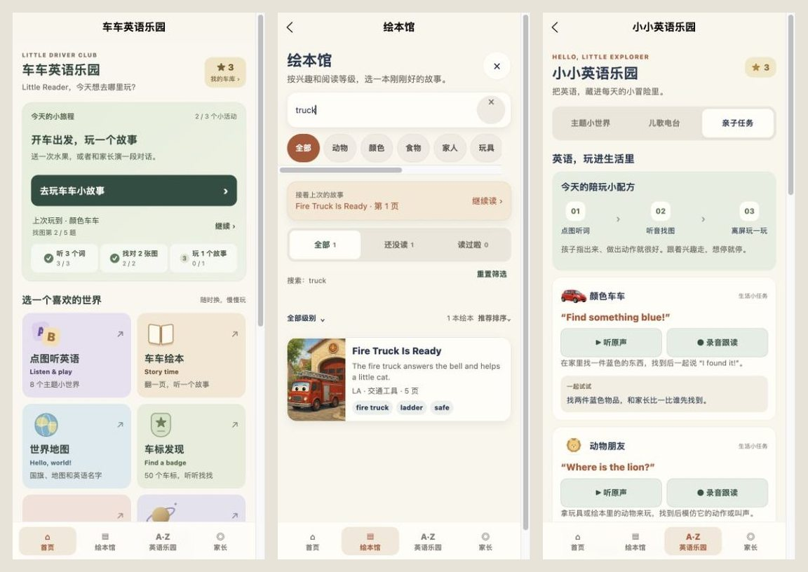
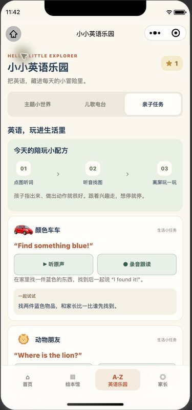

# 学习流程与选书优化 · 2026-10-11

## 变更

- 首页主按钮按当天实际参与记录，依次引导听 3 个词、找对 2 张图、玩 1 个故事。保留单独的上次活动入口；当前步骤匹配保存的主题与模式时，恢复原题位置和已答状态。复习进度不会占用新活动入口。
- 主题卡片显示逐词点读进度；只统计该主题真实播放过的有效单词，不把次数算成新词。主题完成后优先回到首页查看旅程，也可主动去下一站。
- 亲子任务页的 8 条示范句增加原声与录音跟读，复用现有离线音频和录音小册。返回保留亲子标签；页面被替换时也能按来源链接重新打开。
- 绘本馆增加全部／还没读／读过啦的计数与筛选，可与主题、级别和关键词组合；展示筛选摘要、一键重置与针对性的空状态。主题、级别、排序和阅读状态保存在本机，搜索词不保存。检查中复现网页 reLaunch 只触发卸载、漏存筛选，已同时接入 onHide 和 onUnload。
- 搜索时收起推荐大图，聚焦结果；绘本筛选、清除搜索、空状态恢复与公共声音控制按钮至少 44px 高，并修正微信按钮文字居中。

## 验证

- `npm test`、严格发布内容校验、H5 和微信小程序构建通过。新增回归覆盖无效筛选存档、组合计数、重置、退出恢复、首页步骤切换、匹配模式恢复和主题进度去重。
- 跟读检查扩大到 537 组内容上下文；新增 8 个亲子页来源使用已存在的 MP3。H5 构建的 588 个原始媒体文件完整性门槛继续通过。
- 网页实际播放 3 个词，观察首页切到找图；完成 2 题后观察入口切到故事，上次已答题仍可恢复。走完 5 题并确认完成页首要按钮为回首页。验证搜索 truck、已读空状态、重置，以及修复后的筛选退出／重新打开。
- 8 条亲子句逐一实测原声播放、跟读文字和来源标题、原声播放结束，以及返回亲子标签；详见 `web-checks.json`。
- 首页、绘本馆、主题地图、亲子任务在 320／390／430px 共 12 组检查，无页面级横向溢出、已加载破图或新增按钮高度不足；浏览器包含 15px 滚动条，内容宽度相应扣除。截图来自实际页面。
- 微信开发者工具登录最初失效；恢复后重新编译，运行错误为 0。原生验证绘本状态筛选／空状态／重置／离页恢复，主题进度显示，亲子任务进入正确跟读来源、原声实际播放与返回。常规工具预加载和样式警告仍存在；本轮未宣称原生全 35 页复验。

## 包体与交付

最终总包 9.874 MiB，主包 1.491 MiB，学习包 1.365 MiB，阅读包 1.963 MiB，跟读包 1.200 MiB；原有主包 1.5 MiB、单包 2 MiB、总包 20 MiB 门槛保持。主包剩余空间有限，后续功能应继续检查实际构建体积。

运行 ZIP：895 文件、35 路由，CRC 验证通过。SHA256：`3b2ad9d4db7cff57bf7868316f15aacc86a917c3bcd6f4abe9bf3b67675cca28`。发布包启用 URL 校验，不包含开发者私有设置或用户录音。

未采集真实麦克风声音，未发送用户文件，未重新确认实体手机录音、文件保存落盘、静音开关或弱网首次加载；未上传微信体验版或提交审核。

