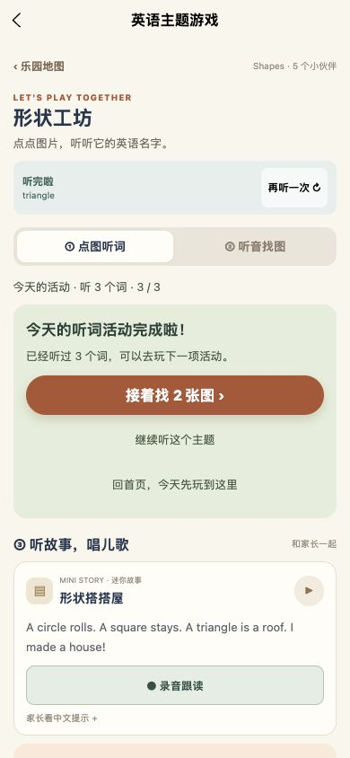
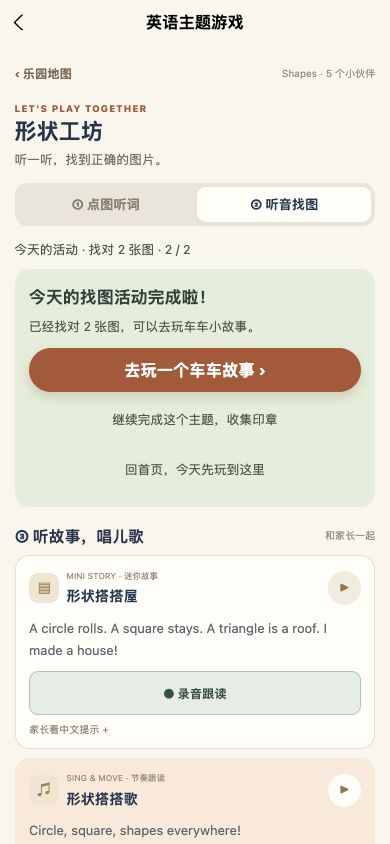

# 学习任务与保存可靠性 · 2026-10-13

## 本轮变更

- 本地写入返回实际结果。失败的最新改动在本次使用期间暂存，页面显示“重新保存记录”；跨页面可继续重试，清除记录后不会被旧的重试恢复。
- 昵称同步保存，录音索引和导入结果立即检查写入结果。失败时不提示“已保存”或“备份恢复完成”；重试只保存已有索引，不重复录音、写音频或再次导入。设置为 0 的音量能正确从本地恢复。
- 主题找图先播放本题英语提示再开放选择，加载失败和静音不会解锁；下一题、切模式和切后台后重新要求提示。首次选对才计入独立找对，错误重试口径不变，旧统计保留。
- 首页每日入口传入每日任务上下文。实际听过三个不同词、找对两张不同图片后展示达标卡，可直接去下一活动、继续完整主题或回首页。两题达标不会提前发放主题印章。
- 继续完整主题的选择与当前题、已答状态一起保存，当天返回可以接着玩；新一天重置每日引导。复习与普通探索保留各自流程。

## 验证

- 类型检查、项目全部自动回归脚本、严格发布内容校验通过。
- 新增 `test:learning-reliability`：模拟存储已满、最新草稿替换、部分恢复与清除、导入索引失败、静音、未听答题、前一题迟到回调、每日达标、续玩、新一天与奖励去重。
- 跟读回归额外模拟音频已经保存、索引写入失败；恢复后只保存一次已有记录。
- 网页生产构建实际播放三个形状词，观察 1/3 → 2/3 → 3/3 达标；进入找图后，未播放提示时点击答案不计分，本题提示播放后才可选择。两题答对后出现 2/2 达标卡。
- 最终网页构建实测主动继续完整主题、返回首页并点击上次活动，直接恢复找图页面，未再次拦截达标提示；证据见 `continue-topic-390.jpg`。
- 达标卡在 320、390、430px 检查，无页面级横向溢出，新增三个按钮至少 44px 高。320/430px 测量保存于 `responsive-checks.json`；截图来自实际页面。
- 微信小程序和 H5 生产构建及媒体完整性、包体检查通过。最终总包 9.881 MiB，主包 1.494 MiB，学习包 1.368 MiB，阅读包 1.964 MiB；原有质量门槛保持。
- 交付 `车车英语乐园-学习可靠性优化版-微信小程序运行包.zip`，启用 URL 校验，未包含开发者私有配置。文件数、路由数与 SHA256 保存于 `package-checks.json`，ZIP CRC 检查通过。

## 范围与限制

未采集真实麦克风声音，未发送用户文件，未上传微信体验版或提交审核。保存失败、录音索引恢复和新一天续玩由自动回归验证；本轮网页实测不能代替实体手机录音、权限和存储容量验收。未写成功的改动仅在本次使用期间暂存，需要在关闭小程序前重新保存。

