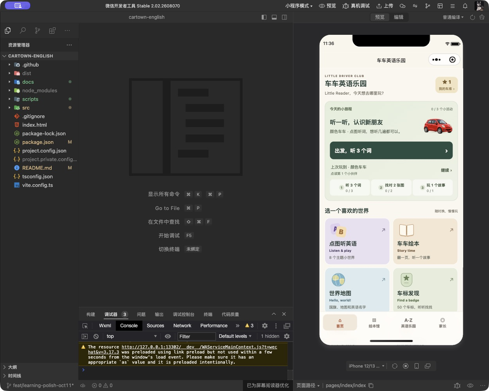

# 微信模拟器启动恢复 · 2026-10-13

## 问题与修复

开发者工具报告“模拟器启动失败：app.json 在项目根目录未找到”。项目根目录配置正确，运行文件实际位于 dist/build/mp-weixin；上轮构建先清空该目录，触发自动热重载读取空目录，开发者工具随后保留了失败状态。

重新打开现有项目后恢复首页；未清除本地学习数据或修改 AppID。已移除旧的 clean-build 脚本，build:mp-weixin 改为先编译到临时目录，通过包体与页面完整性检查后才更新运行文件。文件逐个使用临时文件和 rename 替换，不删除已有 app.json；相同文件不改写，过期文件在更新完成后清理，并保留开发者私有配置。

## 验证

- 微信模拟器实际进入 pages/index/index，显示首页；调试器 Errors: 0。
- 模拟器运行期间使用新流程重建成功，包体检查通过；输出与现有包一致，0 个运行文件改写，首页继续可用。
- 新增 test:build-publish，检查缺失构建、缺失页面拒绝发布、持续可读的 app.json、相同构建不改写、旧文件清理及私有配置保留；已加入 npm run test。
- 主包 1.495 MiB，总包 9.885 MiB。应用运行代码未改变，上轮交付的运行包仍可使用。

