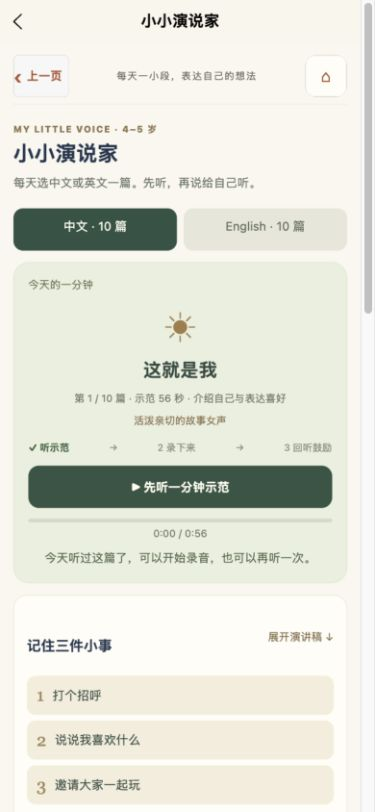

# 小小演说家 · 2026-11-07

## 内容与使用流程

新增中英文各 10 篇原创演说稿。采用“开头介绍 → 具体小事 → 行动或发现 → 分享与结尾”的结构，主题由熟悉的生活走向感受、协商和愿望。每篇中文约 210–226 字，英文约 100–106 词，配三张中文提示卡、四个短段落和一个开放提问。英文提供中文段意提示，不要求孩子背诵整篇或达到固定时长。

选题参考 [NAEYC 的日常故事表达建议](https://www.naeyc.org/our-work/families/everyone-can-be-storyteller) 与 [NAEYC 的 4–6 岁听说支持策略](https://www.naeyc.org/sites/default/files/globally-shared/downloads/PDFs/our-work/global/sels_3-6.pdf)：让孩子讲熟悉的事情、复述或表演、用开放问题邀请自己的想法。这里的 20 篇稿件均为本项目原创，并非转载这些来源的故事。完整稿件见 [SPEECH_SCRIPTS.md](../../SPEECH_SCRIPTS.md)。

每天从首次使用日期起按 10 天循环，语言可选，两个书架保留自由选择。先完整有声听完当前篇，再开放微信录音；暂停、加载失败、音量为零、切换后的旧回调均不会解锁新篇。录制约一分钟为建议，可以随时停止，90 秒自动停止并保存。拒绝麦克风授权时提供设置入口。

录音文件保存失败时保留临时文件与原篇来源，重新进入页面仍可重试；写索引失败使用已有暂存与重新保存入口。换篇、切语言、录新声音前需完成保存。切后台取消示范与待启动录音，已开始的录音通过同一完成回调保存，避免重复记录。演说记录保留最近 90 个日历日，并随清除学习记录一并清除。

录音小册及备份扩展至最近 30 条，能容纳 20 篇练习，旧录音继续沿用。90 秒时长完整保留在备份恢复中。录音保存只表示完成表达，不使用语音评分或额外星星。

## 声音修订

按用户对“自然、流畅、幼儿喜欢”的反馈，更换为中文 `zh-CN-XiaoyiNeural`（活泼故事女声）与英文 `en-US-AnaNeural`（清晰童趣女童声）。具体声线以微软服务返回的当前语音列表为准；通用语音支持说明见 [微软文档](https://learn.microsoft.com/en-us/azure/ai-services/speech-service/language-support?tabs=tts)，生成工具见 [edge-tts](https://github.com/rany2/edge-tts)。

已获得用户明确许可，仅向微软提交这 20 篇原创讲稿用于开发阶段合成。生成时保持正常音高、自然句间停顿，以引擎原生语速调整到约一分钟；不做音频拉伸或用静音补足时长。`audio-manifest.json` 保存声线、原生语速、实际时长、稿件和音频哈希，测试防止误用旧声线、旧文件或变速拉伸结果。应用运行时使用离线 MP3，孩子录音不会发送给示范语音服务。

## 验证范围

最终 20 段新版示范的实际时长为 55.20–63.02 秒，全部成功解码；平均响度为 -23.2 至 -22.1 dB，检查数据见 [audio-levels.json](audio-levels.json)。页面与手机尺寸检查见 [responsive-checks.json](responsive-checks.json)。

最终微信构建总包 14.215 MiB，主包 1.320 MiB，中文演说分包 1.704 MiB，英文音频分包 1.695 MiB，全部门槛通过。世界页专用插画从主包迁入世界分包；录音、进度、音频及日期等共享模块固定在主包，防止非法跨分包同步引用。H5 音频地址使用内容哈希区分版本，避免更换声线后继续命中旧缓存。

- 类型检查、严格内容检查与项目完整回归；新增 `test:speech` 纳入完整测试链。
- 20 篇真实 MP3 的帧时长、不同内容、文件大小和哈希；全部音频解码、非静音与响度检查。
- 每日推荐稳定性、语言切换、10 天循环、跨日重听、异常日期、先听后录、静音、旧回调、加载取消和超时。
- 10/30/90 秒原生录音上限；90 秒自动保存一次、固定篇目来源、文件保存失败重试与重新进页恢复、索引暂存、权限拒绝和后台清理。
- 最近 30 条保存、30 条备份恢复及 90 秒录音时长往返。
- H5 实际检查二十篇切换、中文全文、英文全文及中文段意、完整听播与暂停续听。320/390/430px 页面无横向溢出，按钮高度至少 44px。
- Edge 实际完整播放新版《我家的温暖时刻》，从未听状态播放至 `0:55 / 0:55`，出现“听完啦”并标记“✓ 听示范”；首页和家长中心的入口均实际跳到演说页。完整听播截图见 [edge-complete-playback.png](edge-complete-playback.png)。内置预览曾出现进度停滞，未在 Edge 中复现；未据此修改正常的录音或音频文件。
- 微信构建校验全部分包边界与包体；H5 构建逐字节验证既有 588 个资源及全部 20 段新示范。

H5 不支持本轮录音采集，因此不以网页结果代替微信真机验收。微信的麦克风授权、实体设备录制/自动保存、后台中断、跨分包英文音频和导出到微信文件仍待真机确认。

