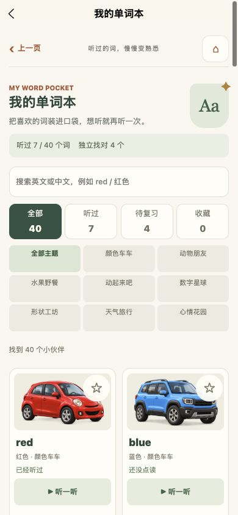
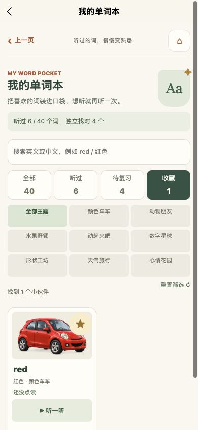
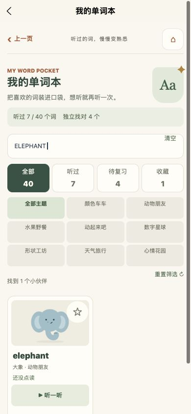
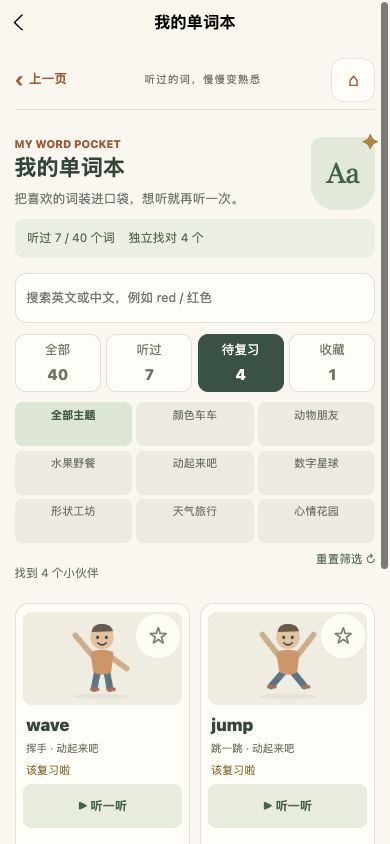

# 我的单词本 · 2026-10-16

## 本轮交付

家长中心顶部新增“我的单词本”，汇总 8 个英语主题的 40 个原有词卡，不新增图片或音频资源。

- 全部、听过、待复习、收藏四个入口，可组合主题筛选和中英文搜索；英文忽略大小写及首尾空格。提供清空搜索、重置筛选和对应空状态。
- 逐词显示学习状态，区分尚未点读、已经听过、独立找对过与到期复习。待复习列表沿用原有复习顺序，点击进入相应主题的复习模式。
- 点击原声播放后，实际开始有声播放才记录已听词，并同步当天听词任务。收藏不会增加独立找对数或星星，旧进度直接沿用。
- 收藏使用独立本地键保存。存储失败时继续使用本次暂存并显示现有重试入口；清除学习记录时同时清除收藏，取消尚未写入的收藏记录。
- 切后台、离开、切换筛选或开始另一个词时取消旧音频；迟到的播放回调不会误计入点读。
- 所有新增页面和收藏服务放在 pkg-user 分包，原有媒体通过 CachedImage 和音频服务加载相应分包。

## 验证

- 类型、严格发布内容检查与项目全部回归通过；新增 test:wordbook 纳入 npm run test。
- 新测试覆盖 40 个真实词、旧记录、收藏去重与非法值、失败保存及重试、清除暂存、主题/搜索/状态组合、静音与迟到回调、当天去重点读、练习模式路由和奖励不增加。
- 实际 H5 从家长中心打开单词本，收藏 red 后列表缩至 1 项；播放后已听从 6 增至 7，刷新后收藏和点读记录保留，验收后取消了测试收藏。
- 搜索“ ELEPHANT ”找到大象；与动物主题组合仍为 1 项，与颜色主题组合为 0 项并显示重置提示。
- 待复习入口显示既有 4 个词，点击动起来吧进入 actions&mode=quiz&review=1，实际页面出现 2 题复习及 Wave hello! 提示，再返回单词本保持筛选。
- 320/390/430px 检查：待复习列表无页面级横向溢出，按钮至少 44px，展示的四张图片均加载成功。原始测量见 responsive-checks.json。
- H5 构建及 588 个原始图片/音频文件字节检查通过；微信生产构建与原有包体门槛通过。总包 9.900 MiB，主包 1.495 MiB，家长分包 0.036 MiB。
- 使用上轮修复的临时目录编译与检查流程更新运行包，未清空模拟器运行目录。

## 验收限制

当前微信开发者工具停在“未登录”扫码页，尚未完成本轮微信模拟器交互验收；实体手机的跨分包图片、音频及切后台行为仍需验证。未申请麦克风权限、未清除用户学习记录、未上传体验版或提交审核。

## 后续适合补充的功能

1. 学习周报：按天汇总听词、找图、故事与复习内容；新增历史应从启用日起真实积累，不能用累计数反推旧数据。
2. 定时听故事：建立轻量播放队列，设置停止时间，记录播放位置，方便离屏听读。
3. 亲子任务日历：把已有线下亲子任务变成可选择、可记录完成情况的小日历。

